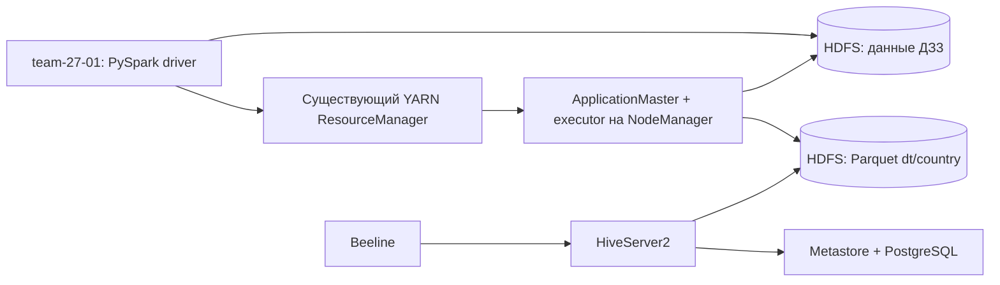

# ДЗ №4 — Apache Spark на YARN, HDFS и Hive

Выполнение задания на стенде **team-27**. Spark запускается с `--master yarn --deploy-mode client`, читает данные ДЗ №3 из существующего HDFS, преобразует их и сохраняет партиционированную таблицу Parquet. Стандартный Hive Beeline проверяет результат через существующий HiveServer2 и PostgreSQL Metastore.

## Что требуется и где реализовано

| Требование | Реализация |
|---|---|
| Spark под управлением YARN предыдущих ДЗ | `scripts/run-spark.sh`, проверка `sc.master == 'yarn'`, application ID и REST ResourceManager |
| Подключение к прежнему HDFS | `config/core-site.xml`, `fs.defaultFS=hdfs://namenode:8020` |
| Чтение заранее загруженных данных | `/user/hive/practical3/orders` — реальные файлы ДЗ №3 |
| Несколько трансформаций | тип даты и Decimal, нормализация строк, фильтр, GROUP BY, count/sum/avg/countDistinct, расчёт НДС |
| Партиционирование при сохранении | `partitionBy('dt','country')`, четыре каталога в HDFS |
| Сохранение таблицы | Spark `saveAsTable('daily_sales')`, затем постоянная внешняя таблица `practical4.daily_sales` в Hive |
| Чтение обычным Hive-клиентом | Beeline → HiveServer2 4.0.0, проверка всех строк, партиций, типов и фильтра |

## Архитектура и версии



- **Spark 3.5.7**, установлен нативно в Python venv на `team-27-01` (`10.27.0.13`), Java 17 для драйвера. Версия 3.5 совместима с Java 8 существующих NodeManager; Spark 4 требует более новую Java на исполнителях.
- **HDFS/YARN Hadoop 3.4.1** из ДЗ №1–2 остаются на `team-27-nn`.
- **Hive 4.0.0** из ДЗ №3 остаётся на `team-27-00`.
- Spark driver работает на свободной ВМ, ApplicationMaster и executor выделяются существующим YARN. Локальный master и отдельный standalone-кластер Spark не используются.
- Используется отдельный закрытый WireGuard `wg-spark`: NN `10.255.28.1`, Spark-узел `.2`, UDP 51828. Это даёт доступ к Docker-сети предыдущих ДЗ и обратные соединения executor → driver на TCP 39001/39002.

### Как связаны каталоги Spark и Hive

Spark 3.5 штатно поддерживает Hive Metastore до версии 3.1.3, а в предыдущем ДЗ установлен Hive 4. Поэтому Spark пишет **совместимые файлы Parquet**, а скрипт регистрирует те же файлы в существующем Hive через `CREATE EXTERNAL TABLE` и `MSCK REPAIR`. Никакой копии строк между Spark и Hive нет.

`saveAsTable` использует каталог текущей Spark-сессии; **постоянные метаданные** таблицы `practical4.daily_sales` хранит прежний PostgreSQL Metastore Hive. Чтение из новой сессии Beeline не зависит от процесса Spark. Embedded Derby не создаётся.

## Предварительные условия

- Доступ к edge: `ssh -i ~/.ssh/macbook_ed25519 team@2.59.81.216`.
- На edge уже есть `.ssh/team_internal`; ключи остаются на своих узлах.
- Ubuntu 24.04, sudo без пароля, свободный `team-27-01` (около 3 GiB RAM).
- Запущены предыдущие HDFS/YARN/Hive, загружена таблица `practical3.orders` с примером из 8 строк.
- Локально нужен Python 3 и OpenSSH. Никаких локальных Hadoop/Spark/Java не требуется.

Исходники предыдущих трёх ДЗ включены в `previous/`; точные коммиты указаны в `previous/versions.json`. В каталогах содержатся только опубликованные Git-файлы: ключей, `.env`, сессий и паролей нет. На **новом учебном стенде** предыдущие компоненты можно подготовить командой:

```bash
python3 scripts/bootstrap-previous.py
```

Скрипт использует версии и Compose-схемы предыдущих ДЗ. Существующие Docker volumes не удаляет. На уже работающем стенде этот шаг пропускается. Полный bootstrap на пустых ВМ отдельно не проверялся; развёртывание Spark и два полных запуска проверены на существующем стенде team-27. Старые задания здесь не переработаны под Ansible: они включены как воспроизводимые зависимости, Spark установлен нативно автоматическим скриптом.

## Развёртывание и запуск

```bash
git clone https://github.com/Foam0/spark-yarn-practical-4.git
cd spark-yarn-practical-4
python3 scripts/deploy.py
python3 scripts/run.py
```

`deploy.py` получает реальные IP контейнеров, копирует только исходники на `/opt/spark-yarn-practical-4`, устанавливает Java/PySpark, настраивает закрытый маршрут и узкие firewall-правила, проверяет существующий входной путь. Spark jars загружаются в HDFS один раз и доступны YARN через `spark.yarn.archive`. При изменении IP контейнеров повторный deploy обновляет `/etc/hosts` и правила.

`run.py`:

1. Выполняет `spark-submit` на Spark-узле; ждёт успешного завершения.
2. Получает отчёт Spark и проверяет наличие удалённого executor.
3. Регистрирует внешний Parquet-результат в Hive без дублирования файлов.
4. Через **обычный Beeline** читает все четыре строки и сравнивает значения, список партиций и результат фильтра.
5. Проверяет через REST YARN тип `SPARK`, состояние `FINISHED`, результат `SUCCEEDED`.
6. Выполняет HDFS fsck и сохраняет полный журнал и JSON-отчёт в `logs/`.

Повторный запуск заменяет только результат этого ДЗ через `overwrite`; исходные данные ДЗ №3 не меняются. Одновременно запускать две копии pipeline нельзя: выходной путь и порты driver фиксированы.

### Память учебного стенда

У двух существующих NodeManager по 768 MiB доступной памяти. Для небольшого примера выбран один executor: 512 MiB heap + 128 MiB overhead, округление YARN до 768 MiB. AM: 128+128 MiB, driver: 768 MiB на отдельном узле. Это параметры для восьми учебных строк; для больших данных нужно увеличить ресурсы. Python UDF нет: на executor выполняются JVM-операторы Spark SQL, Python используется драйвером.

## Обработка данных

`app/transform.py` создаёт **одну** SparkSession и использует её для чтения, всех трансформаций и записи. Источник — разделённые CSV-файлы предыдущего задания в `dt=.../country=...`. Spark извлекает значения партиций из путей и применяет явную схему данных.

Выход: `/user/spark/practical4/daily_sales`, формат Parquet, `dt DATE`, `country STRING`. Остальные поля: количество заказов, сумма, среднее, число разных товаров, условный НДС 20% от суммы.

| dt | country | order_count | gross_amount | avg_amount | product_count | vat_amount |
|---|---|---:|---:|---:|---:|---:|
| 2026-10-01 | KZ | 2 | 70.00 | 35.00 | 2 | 14.00 |
| 2026-10-01 | RU | 2 | 30.00 | 15.00 | 2 | 6.00 |
| 2026-10-02 | KZ | 2 | 150.00 | 75.00 | 2 | 30.00 |
| 2026-10-02 | RU | 2 | 110.00 | 55.00 | 2 | 22.00 |

Итого: вход 8 заказов, 4 результирующие строки, сумма 360, НДС 72. Эти результаты зафиксированы как проверки именно встроенного примера. Для собственного набора нужно изменить входные данные и ожидаемые значения проверок.

## Ручное чтение через Hive

На edge подключитесь к Hive-узлу:

```bash
ssh -i ~/.ssh/team_internal team@team-27-00
cd /opt/hive-cluster-practical-3
sudo scripts/beeline.sh -e "SELECT * FROM practical4.daily_sales;"
sudo scripts/beeline.sh -e "SHOW PARTITIONS practical4.daily_sales;"
sudo scripts/beeline.sh -e "SELECT order_count,gross_amount FROM practical4.daily_sales WHERE dt='2026-10-02' AND country='RU';"
```

Последний запрос должен вернуть `2` и `110.00`. Hive можно читать после завершения драйвера Spark; метаданные сохраняются в PostgreSQL, строки — в HDFS. Для собственного Spark-запуска на узле `team-27-01` используйте `scripts/run-spark.sh`; после него `sql/register.sql` регистрирует таблицу в Hive.

## Диагностика

```bash
# Локально: краткий отчёт полной проверки
cat logs/verification.json
cat logs/spark-result.json
cat logs/hive-rows.tsv

# На Spark-узле
cd /opt/spark-yarn-practical-4
tail -n 50 logs/spark-submit.log
sudo systemctl status wg-quick@wg-spark spark-yarn-route
```

Веб-интерфейсы предыдущего задания доступны существующим способом через edge/SSH. Для этой работы новый публичный сервис не публикуется. Hive authentication NONE и отсутствие Kerberos — существующие упрощения учебного стенда; доступ предусмотрен по SSH и внутренней сети.

Результаты реального запуска: [LIVE.md](LIVE.md).

## Документация

- [Spark 3.5.7: запуск на YARN](https://spark.apache.org/docs/3.5.7/running-on-yarn.html)
- [Установка PySpark](https://spark.apache.org/docs/3.5.7/api/python/getting_started/install.html)
- [Запись и partitionBy](https://spark.apache.org/docs/3.5.7/api/scala/org/apache/spark/sql/DataFrameWriter.html)
- [Hive: внешние таблицы](https://hive.apache.org/docs/latest/language/languagemanual-ddl/)
