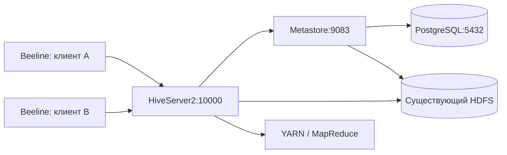

# ДЗ №3 — Apache Hive с несколькими клиентами и партициями

Автоматическое развёртывание **HiveServer2 + отдельного Hive Metastore + PostgreSQL** и загрузка CSV в таблицу `practical3.orders`, партиционированную по дате и стране. Клиенты подключаются удалённо через JDBC; Derby и embedded-сессии не используются.

## Архитектура



| Компонент | Размещение | Доступ |
|---|---|---|
| HiveServer2 | `team-27-00`, 10.27.0.12 | внутренний JDBC, порт 10000 |
| Hive Metastore | тот же узел, отдельный процесс/контейнер | localhost:9083 |
| PostgreSQL 16 | тот же узел, отдельный контейнер | localhost:5432 |
| HDFS / YARN | ранее развёрнуты на `team-27-nn` | закрытый WireGuard-туннель между узлами |
| HiveServer2 Web UI | `team-27-00` | localhost:10002, через SSH |

Используется стабильная **Apache Hive 4.0.0** вместо рекомендованной в задании 4.0.0-alpha2. Официальный образ включает Hadoop-клиент 3.3.6; существующий кластер — Hadoop 3.4.1. Фактическое взаимодействие проверяется скриптом. SQL-агрегация выполняется движком MapReduce через существующий YARN. MR устарел, но позволяет использовать текущий кластер без дополнительного развёртывания Tez.

Это учебный стенд: Hive authentication=NONE, `doAs=false`, пользователи JDBC служат именами сессий, а не проверкой личности. Доступ предусмотрен по внутренней сети через SSH. Metastore, БД и Web UI привязаны к localhost. Данные на HDFS доступны с существующими настройками учебного кластера.

## Требования

- Локально: Python 3, OpenSSH, доступ к edge по своему ключу.
- На узлах Ubuntu 24.04: пользователь `team`, sudo без пароля.
- На edge уже есть ключ `.ssh/team_internal` для внутренних узлов.
- Работающие Compose-проекты `hdfs-lab`, `yarn-lab`, сеть `hdfs-lab_hdfs` на `team-27-nn`.
- У `team-27-00` свободны порты 5432, 9083, 10000, 10002 и достаточно памяти (~3 GiB).

## Развёртывание одной командой

```bash
git clone https://github.com/Foam0/hive-cluster-practical-3.git
cd hive-cluster-practical-3
python3 scripts/deploy-remote.py --edge team@2.59.81.216 --key ~/.ssh/macbook_ed25519
```

Скрипт:

1. Получает текущие адреса контейнеров HDFS/YARN через `docker inspect`.
2. Устанавливает WireGuard на двух внутренних узлах, генерирует ключи только там, создаёт закрытый туннель. Пакеты к Docker-сети идут внутри туннеля, чтобы обращаться к Docker-адресам по закрытому каналу. Docker 28 фильтрует такой трафик ещё в raw/PREROUTING, поэтому скрипт добавляет узкое разрешение только для этого туннеля и нужных TCP-портов.
3. Разрешает в `raw/PREROUTING` и `DOCKER-USER` только адрес Hive-узла в туннеле и необходимые HDFS/YARN TCP-порты (включая динамические RPC-порты ApplicationMaster только на двух NodeManager); сохраняет маршрут и правило в systemd.
4. Разрешает пользователю `hive` выполнять HDFS/YARN-вызовы от имени `hive` только с адреса Hive-узла в туннеле; обновляет конфигурацию через административные refresh-команды без перезапуска кластера. Для localhost-вызовов уведомлений Metastore задано правило proxyuser в клиентской конфигурации. Добавляет 2 GiB swap на сервере HDFS/YARN для кратковременной нагрузки JVM при SQL-агрегации на машине с 4 GiB RAM.
5. Копирует проект в `/opt/hive-cluster-practical-3` на `team-27-00`, устанавливает Docker/Compose и JDBC-драйвер PostgreSQL 42.7.4.
6. Генерирует случайный пароль PostgreSQL в `.env` и `config/hive-site.xml` (оба исключены из Git); пароль сохраняется при повторном запуске.
7. Запускает PostgreSQL, инициализирует/проверяет схему Metastore, запускает отдельный Metastore и HiveServer2. Порядок задан healthcheck-зависимостями; готовность JDBC проверяется реальным `SELECT 1`.
8. Загружает пример CSV в четыре партиции.

Основные версии закреплены в Compose; пароль БД, ключи и jar-файл в публичный репозиторий не попадают. PostgreSQL хранит схему и метаданные в именованном Docker volume, файлы таблицы — в существующем HDFS.

## Как подключиться

На edge:

```bash
ssh -i ~/.ssh/team_internal team@team-27-00
cd /opt/hive-cluster-practical-3
sudo HIVE_CLIENT_USER=student_a scripts/beeline.sh
```

В другой SSH-сессии:

```bash
cd /opt/hive-cluster-practical-3
sudo HIVE_CLIENT_USER=student_b scripts/beeline.sh
```

Оба клиента идут через один HiveServer2 и могут держать независимые сессии одновременно. Для JDBC-клиента на своём компьютере создайте туннель:

```bash
ssh -i ~/.ssh/macbook_ed25519 -N -L 10000:10.27.0.12:10000 team@2.59.81.216
```

Затем подключитесь Beeline/DBeaver по `jdbc:hive2://localhost:10000/default`, с произвольным именем пользователя учебного стенда, без пароля. Не используйте `jdbc:hive2:///` — это embedded-режим.

## Автоматическая загрузка

Пример: `data/orders.csv`, 8 заказов, две даты, две страны. Одна строка содержит данные и значения партиции. Загрузчик валидирует типы/значения, разделяет файл на группы, удаляет из файлов колонки партиционирования и выполняет:

```sql
CREATE EXTERNAL TABLE practical3.orders (
  order_id INT, product STRING, amount DECIMAL(10,2)
)
PARTITIONED BY (dt STRING, country STRING)
ROW FORMAT DELIMITED FIELDS TERMINATED BY ','
STORED AS TEXTFILE
LOCATION '/user/hive/practical3/orders';

LOAD DATA LOCAL INPATH '/tmp/hive-load/2026-10-01_RU.csv'
OVERWRITE INTO TABLE practical3.orders
PARTITION (dt='2026-10-01', country='RU');
```

`LOCAL` означает файл на сервере HiveServer2, поэтому скрипт сначала копирует файлы в его контейнер. `LOAD DATA` помещает их в HDFS и регистрирует статические партиции в Metastore; этот шаг не требует MapReduce. Запрос `GROUP BY` проверяет вычисления через YARN отдельно.

Повторная загрузка тех же партиций заменяет их данные через `OVERWRITE` и не создаёт дубликатов. Партиции, отсутствующие в новом CSV, сохраняются. Это загрузка полных снимков отдельных партиций, а не инкрементальное добавление заказов.

На Hive-узле:

```bash
cd /opt/hive-cluster-practical-3
sudo scripts/load-data.sh                # встроенный пример
sudo scripts/load-data.sh /path/to/orders.csv
```

Проверка вручную:

```sql
SHOW PARTITIONS practical3.orders;
SELECT * FROM practical3.orders WHERE dt='2026-10-01' AND country='RU';
SELECT country, COUNT(*), SUM(amount) FROM practical3.orders GROUP BY country;
```

Ожидается 4 партиции, всего 8 строк. `RU: 4, 140`, `KZ: 4, 220`, общая сумма 360. Фильтр по первой дате и RU возвращает заказы 1 и 2. Файлы находятся в `/user/hive/practical3/orders/dt=.../country=.../`.

## Автоматическая проверка

```bash
cd /opt/hive-cluster-practical-3
sudo python3 scripts/verify.py
```

Проверяется полный список партиций, точное содержимое всех 8 строк, запрос по одной партиции и план запроса, SQL-агрегация, две одновременно открытые JDBC-сессии `client_a`/`client_b`, PostgreSQL schema version и HDFS fsck. Логи сохраняются в `logs/`.

`verify-concurrent.py` держит оба процесса Beeline с открытым stdin до получения ответов обоих клиентов и проверяет два установленных TCP-соединения на серверном порту 10000. Поэтому успешный последовательный запуск двух клиентов не будет считаться проверкой одновременности.

## Сохранность и управление

```bash
sudo docker compose ps
sudo docker compose logs --tail 50 metastore hiveserver2
sudo docker compose restart
sudo docker compose up -d --wait --wait-timeout 300
sudo python3 scripts/verify.py
sudo docker compose down                 # volume и HDFS остаются
sudo bash scripts/deploy.sh              # запуск + повторная загрузка примера
```

Не удаляйте volume БД и `.env`, если хотите сохранить метаданные и пароль. Если адреса контейнеров HDFS/YARN изменились после их пересоздания, повторите `deploy-remote.py`: он обновит `extra_hosts`. Запуск существующих контейнеров после обычного restart сохраняет адреса. Для другой топологии необходимо изменить фиксированные адреса team-27 в скрипте и генераторе конфигурации.

## Документация Apache

- [Официальное развёртывание Docker с PostgreSQL и удалённым Metastore](https://hive.apache.org/docs/latest/admin/setting-up-hive-with-docker/)
- [HiveServer2: несколько клиентов](https://hive.apache.org/docs/latest/admin/setting-up-hiveserver2/)
- [JDBC / Beeline](https://hive.apache.org/docs/latest/user/hiveserver2-clients/)
- [DDL, партиционированные таблицы](https://hive.apache.org/docs/latest/language/languagemanual-ddl/)
- [DML, LOAD DATA](https://hive.apache.org/docs/latest/language/languagemanual-dml/)

Результаты фактической проверки: [LIVE.md](LIVE.md).
