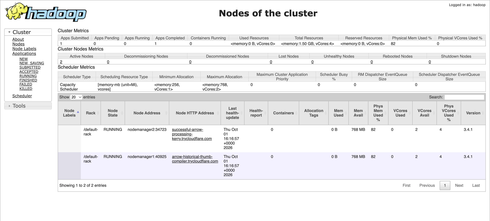
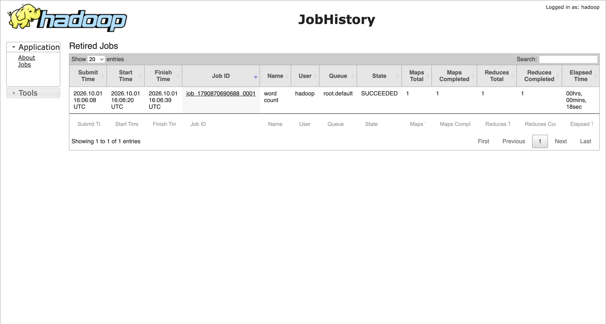
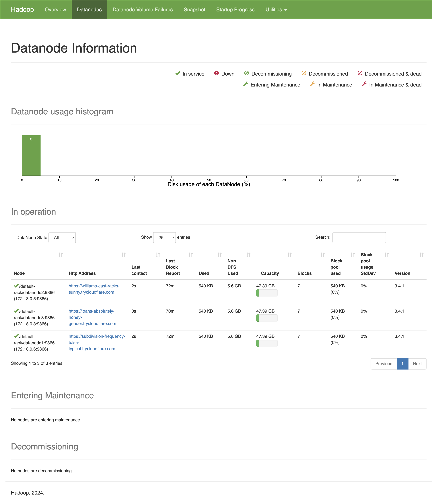

# Работающий стенд и проверка

Развёртывание и WordCount проверены 2026-10-01 на учебном стенде team-27. Внешние ссылки обновлены и повторно проверены 2026-10-09: все десять страниц возвращают HTTP 200, REST API и переход к истории задания работают; POST через публичный proxy запрещён.

На сервере `team-27-nn` YARN находится в `/opt/yarn-cluster-practical-2`, HDFS — в `/opt/hdfs-cluster-practical-1`. Файлы публикации на edge — `/home/team/yarn-cluster-practical-2`, служба — `hadoop-web-tunnels.service`.

## Внешние интерфейсы

| Интерфейс | HTTPS-ссылка |
| --- | --- |
| Общая страница | [Общая страница](https://kinda-dispatch-solely-encyclopedia.trycloudflare.com/) |
| ResourceManager | [ResourceManager](https://repairs-dosage-tour-trinity.trycloudflare.com/) |
| NodeManager 1 | [NodeManager 1](https://generators-outside-strengthening-desert.trycloudflare.com/) |
| NodeManager 2 | [NodeManager 2](https://texture-commerce-treasure-beverly.trycloudflare.com/) |
| JobHistoryServer | [JobHistoryServer](https://bloom-endless-isle-cartoon.trycloudflare.com/) |
| NameNode | [NameNode](https://says-void-requires-earlier.trycloudflare.com/) |
| SecondaryNameNode | [SecondaryNameNode](https://cannon-cet-nurse-making.trycloudflare.com/) |
| DataNode 1 | [DataNode 1](https://exploring-less-county-messenger.trycloudflare.com/) |
| DataNode 2 | [DataNode 2](https://acre-seller-scenarios-goal.trycloudflare.com/) |
| DataNode 3 | [DataNode 3](https://acknowledged-acid-lynn-foot.trycloudflare.com/) |

Адреса Quick Tunnels действуют, пока работают процессы публикации. После перезапуска взять актуальные адреса на edge командой `sudo cat /var/lib/hadoop-web/public-urls.json`. Эти ссылки отражают состояние на дату проверки.

## Результаты

- ResourceManager работает, зарегистрированы **2 RUNNING NodeManager**, Lost/Unhealthy/Decommissioning = 0.
- WordCount действительно выполнен через YARN (`uber mode: false`): `application_1790870690688_0001` — `FINISHED`, `SUCCEEDED`.
- JobHistoryServer сохранил `job_1790870690688_0001` — `SUCCEEDED`, выполнены 1 map и 1 reduce.
- Результат из HDFS точно совпал с ожидаемым:

```text
hadoop  1
hdfs    1
yarn    2
```

- HDFS: **3 Live DataNode, 0 Dead DataNode**, потерянных и повреждённых блоков нет; `fsck` файлов задания — `HEALTHY`.
- Все девять интерфейсов и портал проверены с внешнего компьютера: HTTP 200, переходы между сервисами работают.
- Проверены внешние REST API, ссылка tracking URL на завершённое задание и запрет POST через nginx.
- ResourceManager, JobHistoryServer и таблица DataNode дополнительно проверены в отдельном Chrome: страницы заполнены, внешние ссылки исправны.
- У девяти контейнеров на момент проверки `OOMKilled=false`, `RestartCount=0`.
- Повторный `deploy.sh` также завершился успешно: `application_1790870690688_0002` и `job_1790870690688_0002` — `SUCCEEDED`; данные предыдущей проверки сохранились.

## Снимки интерфейсов

Снимки сделаны при проверке развёртывания 2026-10-01.

### ResourceManager: два рабочих узла



### JobHistoryServer: успешный WordCount



### NameNode: три рабочих DataNode


